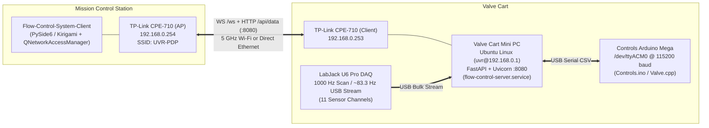

# Flow Control System Server — Documentation

Welcome to the technical documentation for the **Flow Control System Server** (`flow-control-server`), the Python backend service running on the **Valve Cart Mini PC** (`uvr@192.168.0.1`).

The server is implemented across [`contents/code/`](../contents/code/) using **FastAPI + Uvicorn** (`WS /ws` + streaming `HTTP /api/data`), Pydantic-validated sensor configuration (`sensors.json`), full-rate LabJack U6 USB instrumentation (`instrumentation.py` + `thermocouple.py`), two-row CSV session recording (`data_recorder.py`), unified console logging (`logging_config.py`), and automatic mock simulation (`mocks.py`) when hardware is absent. Controls Arduino serial integration (`serial_controller.py`) is specified in [`actuation-spec.md`](./actuation-spec.md) for drop-in hardware integration.

---

## Contents

1. **[Architecture, LabJack U6 & Serial Overview (`protocol-and-architecture.md`)](./protocol-and-architecture.md)**
   - End-to-end communication topology: **Mission Control Client ↔ FastAPI/Uvicorn Server ↔ Controls Arduino & LabJack U6**.
   - Architectural rationale replacing legacy `PDP-Monitoring-System` bottlenecks (unified port `8080`, in-memory `asyncio.Queue` FIFO vs. `tmp.txt`/`LifoQueue`, `VC,SUMMARY` full-packet parsing, pure Python runtime).
   - Validated [`contents/config/sensors.json`](../contents/config/sensors.json) schema, LabJack U6 channel calibration (`kPa`, `M_RUN_TANK` in `kg`, `L_THRUST` in `N`, `°C`), and open-thermocouple `NaN` fault alerting.

2. **[WebSocket & HTTP `/api/data` Protocol Specification (`websocket-protocol.md`)](./websocket-protocol.md)**
   - Complete **`WS /ws`** JSON/JSONL contract (`init` with `channels` metadata, `telemetry`, `valve_state`/`summary`, `armed`, `alert`, `command`, `abort`, `unabort`, `record`) plus server-side safety interlocks.
   - Streaming **`HTTP /api/data/...`** endpoints (`GET /api/data`, `GET /api/data/{filename}`, `PUT /api/data/{filename}`, `POST /api/data/{filename}/rename`, `DELETE /api/data/{filename}`) and legacy WebSocket `remote_data_req` fallback + Deferred File Deletion semantics.

3. **[Actuator Controls & Arduino Serial Specification (`actuation-spec.md`)](./actuation-spec.md)**
   - Interface contract for `contents/code/serial_controller.py` on `server.serial_controller` (`/dev/ttyACM0 @ 115200` baud), `Controls.ino` CSV protocol, USB hotplug resilience, and legacy firmware bug workarounds.

4. **[Implementation Roadmap (`roadmap.md`)](./roadmap.md) & [Maintainability Roadmap (`maintainability-roadmap.md`)](./maintainability-roadmap.md)**
   - Phase status across server modules, ops scripts, CI verification, and upcoming `serial_controller.py` hardware integration.

---

## Hardware & Network Topology

---

## Deployment & Operations Tooling (`tools/`)

- **[`tools/_common.sh`](../tools/_common.sh):** Shared SSH (`SSH_ASKPASS` / `sshpass` / `ControlMaster`), `password.txt`, and remote `sudo -S` plumbing.
- **[`tools/push-code.sh`](../tools/push-code.sh):** Incremental `rsync -avz --delete` protecting remote `data/` and `.venv/`, offline-safe `.venv` dependency installation (wheelhouse or PyPI with short timeout), installs [`contents/config/flow-control-server.service`](../contents/config/flow-control-server.service), and restarts `systemd`.
- **[`tools/services.sh`](../tools/services.sh):** Manage `systemd` (`status`, `restart`, `start`, `stop`, `logs [-f]`, `enable`, `disable`) and download/push offline Python wheels + LabJack `exodriver` (`fetch-deps`, `push-deps`).
- **[`tools/direct-ethernet.sh`](../tools/direct-ethernet.sh):** Configures PC-to-cart direct Ethernet links (`initiate`, `restore`, `status`, `install-server`, `server-detect`) alongside [`contents/code/direct-eth-detect.sh`](../contents/code/direct-eth-detect.sh).
