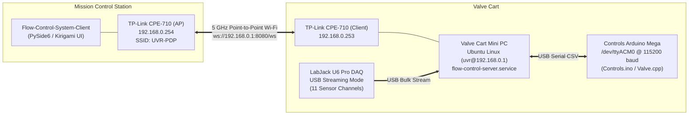

# Flow Control System Server — Documentation

Welcome to the technical documentation for the **Flow Control System Server** (`flow-control-server`), the Python backend service running on the **Valve Cart Mini PC** (`uvr@192.168.0.1`).

Currently, [`contents/code/main.py`](../contents/code/main.py) is a stub (`print("hello world")`), while the deployment tooling ([`tools/push-code.sh`](../tools/push-code.sh), [`tools/services.sh`](../tools/services.sh)) and `systemd` service unit ([`contents/config/flow-control-server.service`](../contents/config/flow-control-server.service)) are fully operational. This documentation specifies the server architecture, communication protocols, design rationale, and implementation roadmap drawing from the reference [`PDP-Monitoring-System`](../../PDP-Monitoring-System/) and [`PDP-Ground-Support-Rewrite`](../../PDP-Ground-Support-Rewrite/) codebases.

---

## Contents

1. **[Communication Protocol & Architecture (`protocol-and-architecture.md`)](./protocol-and-architecture.md)**
   - End-to-end communication topology: **Mission Control Client ↔ Valve Cart Server ↔ Controls Arduino & LabJack U6**.
   - **WebSocket Protocol (`ws://192.168.0.1:8080/ws`)**: JSON/JSONL packet schemas for live telemetry broadcast, valve actuation commands, limit-switch state updates, emergency abort, on-cart recording, and remote log file management.
   - **USB Serial Protocol (`/dev/ttyACM0 @ 115200`)**: CSV command/response specification (`MCC`/`VC`, `CTRL`, `ABORT`, `UNABORT`, `CONNECT`, `SUMMARY`, `STATUS`, `ERROR`) interfacing with `Controls.ino`.
   - **LabJack U6 Instrumentation Pipeline**: Channel mappings (`AIN49`–`AIN87`), differential vs. single-ended gains, cold-junction thermocouple compensation (`thermocouple.py`), and unit conversions.
   - **Architectural Reasoning**: Why specific design flaws in the legacy `PDP-Monitoring-System` (`LifoQueue`, `tmp.txt` IPC file polling, dual WebSocket ports `8080`/`8888`, early return in `SUMMARY` parsing) are replaced with a unified `asyncio` architecture.

2. **[Server Implementation Roadmap (`roadmap.md`)](./roadmap.md)**
   - Phased engineering plan to build out `Flow-Control-System-Server/contents/code/` from the reference modules in `PDP-Monitoring-System` and `PDP-Ground-Support-Rewrite`.
   - Module breakdown, unit conversion formulas, simulation/mock mode (`--mock`), on-cart telemetry logging, remote file transfer handlers, and hardware-in-the-loop verification.

3. **[WebSocket Protocol Specification (`websocket-protocol.md`)](./websocket-protocol.md)**
   - Complete Server $\leftrightarrow$ Client JSON/JSONL wire contract (`init`/`actuators`/`config`, `telemetry`, `valve_state`/`summary`, `armed`, `alert`, `command`, `abort`, `record`, `remote_data_req`/`remote_data_list`/`remote_data_content`), state normalization, and the **Deferred File Deletion Protocol**.

---

## Hardware & Network Topology

---

## Deployment & Operations Tooling (Already Implemented)

The server repository includes automated deployment and service management scripts in [`tools/`](../tools/):

- **[`tools/push-code.sh`](../tools/push-code.sh)**:
  - Uses `SSH_ASKPASS` / `sshpass` with `ControlMaster` multiplexing and `rsync -avz --delete` to push code incrementally to `uvr@192.168.0.1:/home/uvr/Flow-Control-System-Server`.
  - Automatically installs [`contents/config/flow-control-server.service`](../contents/config/flow-control-server.service) to `/etc/systemd/system/`, reloads `systemd`, enables autostart on boot, and restarts the service.
  - **Why this design:** Eliminates manual SCP/SSH steps on the test pad and guarantees the Valve Cart Mini PC automatically restarts the server (`Restart=always`, `RestartSec=3`) if a power dip or process crash occurs.
- **[`tools/services.sh`](../tools/services.sh)**:
  - Provides both CLI subcommands (`status`, `restart`, `start`, `stop`, `logs -f`, `enable`, `disable`) and an interactive menu for managing `flow-control-server.service` and tailing `journald` logs remotely.
