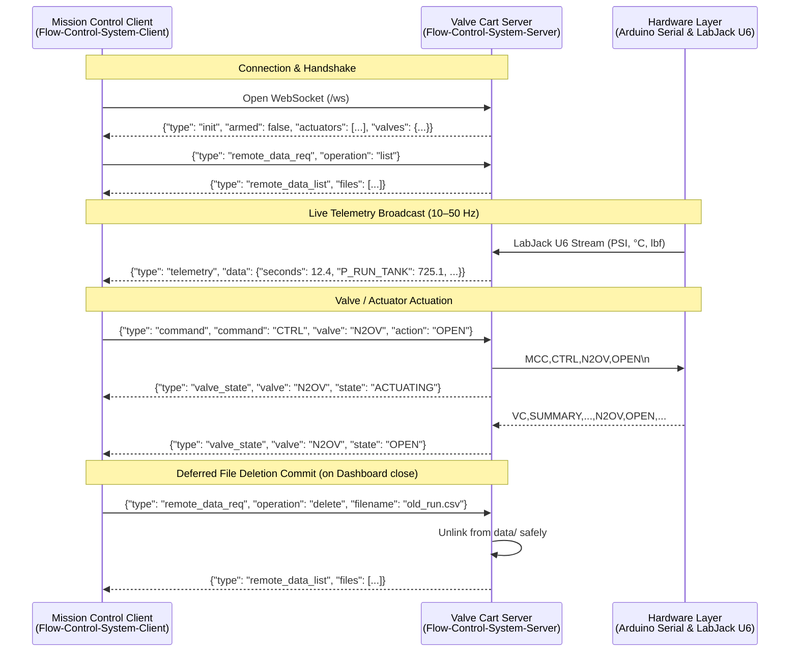

# WebSocket Protocol Specification (Server ↔ Client)

This document specifies the WebSocket server contract and wire protocol that **Flow Control System Server** (`Flow-Control-System-Server`) must implement to communicate with **Flow Control System Client** (`Flow-Control-System-Client`).

For hardware serial (`Controls.ino`) and LabJack U6 acquisition details, see [`protocol-and-architecture.md`](./protocol-and-architecture.md).

---

## 1. Transport & Endpoint

- **Endpoint:** `ws://0.0.0.0:8080/ws`
  - Production Valve Cart Mini PC: `ws://192.168.0.1:8080/ws`
  - Local Development / Mock Server: `ws://127.0.0.1:8080/ws`
- **Framing:** UTF-8 text frames containing **JSON objects** (or newline-delimited **JSONL** batches for high-rate telemetry).
- **Multi-Client Support:** The server should maintain a `set` of connected WebSocket clients and broadcast state changes (`telemetry`, `valve_state`, `armed`, `alert`) to all connected clients, while replying directly (or broadcasting where appropriate) to `init` and `remote_data_req` requests.

---

## 2. End-to-End Server $\leftrightarrow$ Client Message Flow



---

## 3. Connection Lifecycle Expectations

When a client connects or reconnects, the server should expect the following automatic client behaviors:

1. **Immediate Handshake (`init`):**
   - Upon accepting a WebSocket connection on `/ws`, the server should immediately send an `"init"` packet containing `"armed"`, `"actuators"` (or `"valve_definitions"`), and current `"valves"` states.
2. **Automatic Remote File List Request:**
   - Immediately upon `ws_connected == true`, the client sends `{"type": "remote_data_req", "operation": "list"}`.
3. **Automatic Recording Re-Sync:**
   - If the client already has local telemetry recording active when a WebSocket connection is established (or re-established after a drop), the client automatically sends `{"type": "record", "command": "RECORD", "active": true, "session_name": "...", "filename": "..."}`.
   - The server should idempotently ensure recording is active (avoiding duplicate/corrupted file handles if already recording the same session).
4. **Disconnect Safety:**
   - When the WebSocket closes, the client immediately resets its local `armed` state to `false` (SAFE) and emits `disconnected` / `websocket_closed`.

---

## 4. WebSocket Wire Protocol Specification

### 4.1 Server $\rightarrow$ Client Messages

#### A. Initial State & Actuator Config (`type: "init" | "actuators" | "config"`)
Sent immediately when a client connects, or whenever the server's actuator configuration changes. Synchronizes armed status, dynamic actuator definitions, and current valve/actuator states.

- `"actuators"` (or `"valve_definitions"`) can also be attached to **any** control message; if present as a list, the client dynamically updates its actuator cards.
- `"valves"` may be either a state dictionary (`{"ID": "STATE"}`) or, when sent with `"type": "init" | "actuators" | "config"`, a list of actuator definition objects.

- `"recording"` (`bool`, optional) and `"recording_filename"` (or `"active_log"`, `string`, optional): Indicates whether the server is currently recording telemetry. If `"recording": true` when a second client connects, the client prompts the user to either pull the current recorded state (`mode: "pull_recording"`) or wait for recording to stop while logging live telemetry in memory.

```json
{
  "type": "init",
  "armed": false,
  "recording": false,
  "recording_filename": null,
  "actuators": [
    {
      "id": "MEV",
      "label": "Main Engine Valve",
      "type": "servo",
      "normal_state": "CLOSED",
      "key": "M",
      "hint": "Primary propellant valve",
      "external": false,
      "single_use": false
    },
    {
      "id": "N2OV",
      "label": "N2O Fill / Vent",
      "type": "solenoid_3way",
      "normal_state": "VENT",
      "key": "V",
      "hint": "3-way fill/vent solenoid",
      "external": false,
      "single_use": false
    },
    {
      "id": "QD",
      "label": "Quick Disconnect",
      "type": "solenoid_qd",
      "normal_state": "CONNECTED",
      "key": "Q",
      "hint": "Ground umbilical disconnect",
      "external": true,
      "single_use": true
    },
    {
      "id": "IGN",
      "label": "Igniter E-Match",
      "type": "ematch",
      "normal_state": "CLOSED",
      "key": "I",
      "hint": "Pyro ignition channel",
      "external": false,
      "single_use": true
    }
  ],
  "valves": {
    "MEV": "CLOSED",
    "N2OV": "VENT",
    "QD": "CONNECTED",
    "IGN": "CLOSED"
  }
}
```

**Actuator Definition Fields:**
- `id` (`string`): Unique actuator identifier used in commands and state maps.
- `label` (`string`): Human-readable card title.
- `type` (`string`): One of `"servo"`, `"solenoid_3way"`, `"solenoid_qd"`, `"ematch"`.
- `normal_state` (`string`): Expected safe/resting state (`"CLOSED"`, `"VENT"`, `"CONNECTED"`).
- `key` (`string`): Optional keyboard shortcut hint.
- `hint` (`string`): Optional description shown on the actuator card.
- `external` (`bool`): If `true`, actuation is disabled in the client UI (read-only/external hardware).
- `single_use` (`bool`): If `true`, the client locks out further actuation once expended (`DISCONNECTED` or `FIRED`).

> **Legacy Compatibility (`PDP-Monitoring-System`):** Legacy `{"identifier": "STARTUP", "data": "VC CONNECTED"}` is accepted by the client.

#### B. Live Telemetry Frame (`type: "telemetry"`)
Broadcasted continuously from the LabJack U6 acquisition loop (or mock generator) in engineering units (`PSI`, `°C`, `lbf`). The client accepts three payload layouts (single JSON frames or newline-delimited JSONL batches):

**Layout 1 — Grouped Sub-Dictionaries:**
```json
{
  "type": "telemetry",
  "data": {
    "packet_id": 1042,
    "seconds": 104.2,
    "uptime": 104.2,
    "pressures": {
      "P_RUN_TANK": 742.5,
      "P_N2O_FLOW": 612.1,
      "P_N2_FLOW": 795.0,
      "P_COMB_CHMBR": 418.3,
      "P_INJECTOR": 538.9
    },
    "temperatures": {
      "T_RUN_TANK": 19.4,
      "T_INJECTOR": 24.1,
      "T_COMB_CHMBR": 685.0,
      "T_POST_COMB": 512.7
    },
    "loads": {
      "L_RUN_TANK": 48.6,
      "L_THRUST": 412.0
    }
  }
}
```

**Layout 2 — Flat Channel Dictionary:**
```json
{
  "type": "telemetry",
  "data": {
    "seconds": 104.2,
    "P_RUN_TANK": 742.5,
    "T_RUN_TANK": 19.4,
    "L_THRUST": 412.0
  }
}
```

**Layout 3 — Raw Telemetry Object (Unwrapped):**
```json
{
  "seconds": 104.2,
  "P_RUN_TANK": 742.5,
  "T_RUN_TANK": 19.4
}
```
- Time indexing checks `"seconds"` $\rightarrow$ `"uptime"` $\rightarrow$ `"time"` $\rightarrow$ server/client `time.time()`. Unix epoch timestamps ($>10^6$) are automatically anchored to $t = 0\text{ s}$ on the client.
- Any unrecognized numeric key is auto-registered by the client with units inferred from its prefix (`P_` $\rightarrow$ `PSI`, `T_` $\rightarrow$ `°C`, `L_` $\rightarrow$ `lbf`).

#### C. Valve State Update (`type: "valve_state" | "summary"`)
Sent whenever a valve/actuator changes state or in response to a state summary poll.
```json
{
  "type": "valve_state",
  "valve": "MEV",
  "state": "OPEN"
}
```
- Supports **single-valve updates** (`"valve"` and `"state"`) and/or **bulk summary updates** (`"valves": {"MEV": "OPEN", "N2OV": "FILL", ...}`).
- **Client State Normalization:** The client uppercases states and maps firmware/legacy aliases:
  - `"CLOSE"` $\rightarrow$ `"CLOSED"`
  - `"TRANSIT"` $\rightarrow$ `"ACTUATING"`
  - `"FILLING"` $\rightarrow$ `"FILL"`
  - `"VENTING"` $\rightarrow$ `"VENT"`
- **Valid Normalized States:**
  - `servo`: `"OPEN"`, `"CLOSED"`, `"ACTUATING"`
  - `solenoid_3way`: `"FILL"`, `"VENT"`
  - `solenoid_qd`: `"CONNECTED"`, `"DISCONNECTED"`
  - `ematch`: `"CLOSED"`, `"FIRED"`

> **Legacy Compatibility (`PDP-Monitoring-System`):** `{"identifier": "FEEDBACK", "data": {"valve": "MEV", "action": "OPEN"}}` is also accepted.

#### D. Armed State Update (`type: "armed"`)
Synchronizes the client's **SAFE / ARMED** interlock state:
```json
{
  "type": "armed",
  "armed": true
}
```

#### E. System Alert / Diagnostic Notification (`type: "alert"`)
Displays a toast notification and logs an entry in the client's Notification Tray:
```json
{
  "type": "alert",
  "level": "WARN",
  "message": "Hardware keyswitch is in SAFE lockout position; stepper motion inhibited."
}
```
- `level`: `"INFO"`, `"WARN"`, or `"ERR"`.

#### F. Remote Data File Management (`type: "remote_data_list"` / `"remote_data_content"`)
Sent in response to client `remote_data_req` operations:
```json
{
  "type": "remote_data_list",
  "files": [
    {"name": "run_2026_11_04_hotfire.csv"},
    "run_2026_11_04_coldflow.csv"
  ]
}
```
- Entries in `"files"` may be either strings (`"filename.csv"`) or objects with a `"name"` key (`{"name": "filename.csv", ...}`).

When serving a file requested with `"operation": "get"`:
```json
{
  "type": "remote_data_content",
  "filename": "run_2026_11_04_hotfire.csv",
  "mode": "load",
  "content": "psi,psi,s\nP_RUN_TANK,P_INJECTOR,seconds\n740.1,539.2,0.0\n..."
}
```
- `"mode"` must echo the client's requested mode (`"load"`, `"download"`, or `"pull_recording"`).
  - When `"mode" == "pull_recording"` (triggered when a second user connects mid-recording and chooses to pull the current recorded state), the server should flush/read the currently active recording CSV (using `"filename"` if provided, or the active recording file if empty) and return its contents so far.

---

### 4.2 Client $\rightarrow$ Server Messages

#### A. Valve / Actuator Actuation Command (`type: "command"`)
Sent when the operator actuates a device while the client is **ARMED**:
```json
{
  "type": "command",
  "command": "CTRL",
  "valve": "MEV",
  "action": "OPEN"
}
```
- `action`: Uppercased action string (`"OPEN"`, `"CLOSE"`, `"FILL"`, `"VENT"`, `"DISCONNECT"`, `"FIRE"`).
- **Server Validation:** Even though the client enforces `armed == true`, `!external`, and `!expended(single_use)` interlocks, the server should independently validate actuator IDs, valid actions, and hardware safety interlocks before writing `MCC,CTRL,<VALVE>,<ACTION>\n` to serial.

#### B. Emergency Abort (`type: "abort"`)
Sent immediately when the operator triggers **Safety Override (CLOSE ALL VALVES)** or presses `[Space]`. **Always permitted even when the client is in SAFE mode.**
```json
{
  "type": "abort",
  "command": "ABORT"
}
```
- **Server Action:** Clear any pending command queue, immediately write `MCC,ABORT\n` to Arduino serial, broadcast an `"ERR"` `"alert"` to all connected clients, and broadcast updated `"valve_state"` frames as `VC,SUMMARY,...` arrives.

#### C. Server Telemetry Recording Control (`type: "record"`)
Sent when the operator toggles **Record telemetry** in the client top bar (or automatically re-sent on reconnect if local recording is active):
- **Start Recording:**
```json
{
  "type": "record",
  "command": "RECORD",
  "active": true,
  "session_name": "telemetry_2026_11_14_100500.csv",
  "filename": "telemetry_2026_11_14_100500.csv"
}
```
- **Stop Recording:**
```json
{
  "type": "record",
  "command": "RECORD",
  "active": false
}
```
- **Server Action:** Open/close the CSV telemetry log in the server's `data/` directory using the provided sanitized `filename` (or `session_name`), and broadcast `"remote_data_list"` when a new recording finishes so clients see the saved file.

#### D. Remote Data File Operations (`type: "remote_data_req"`)
Sent by the client's Dashboard file manager:
- **List files:**
```json
{
  "type": "remote_data_req",
  "operation": "list"
}
```
  - Server replies with `remote_data_list`.
- **Get file (Load or Download):**
```json
{
  "type": "remote_data_req",
  "operation": "get",
  "filename": "run_2026_11_04_hotfire.csv",
  "mode": "load"
}
```
  - `"mode"` is `"load"` or `"download"`. Server replies with `remote_data_content` (or `"alert"` with `level: "ERR"` if missing).
- **Rename file:**
```json
{
  "type": "remote_data_req",
  "operation": "rename",
  "old_name": "a.csv",
  "new_name": "b.csv"
}
```
  - Server renames the file safely within `data/` and replies/broadcasts updated `remote_data_list`.
- **Delete file (Deferred Commit — see Section 5):**
```json
{
  "type": "remote_data_req",
  "operation": "delete",
  "filename": "a.csv"
}
```
  - Server unlinks the file safely within `data/` and replies/broadcasts updated `remote_data_list`.

> **Security Requirement:** The server must sanitize all `filename`, `old_name`, `new_name`, and `session_name` values (e.g., `Path(name).name`, rejecting `..` or path separators) so file operations cannot escape the server's `data/` directory.

#### E. Optional / Reserved Server Commands (`summary`, `unabort`)
Supported by the server serial bridge if triggered by future UI controls or diagnostic tools:
- **Request State Summary:** `{"type": "summary", "command": "SUMMARY"}` $\rightarrow$ writes `MCC,SUMMARY\n`.
- **Clear Abort State:** `{"type": "unabort", "command": "UNABORT"}` $\rightarrow$ writes `MCC,UNABORT\n`.

---

## 5. Deferred File Deletion Protocol

To prevent accidental loss of irreplaceable test-fire telemetry logs, `Flow-Control-System-Client` implements a **soft-delete / deferred commit pattern** (`pendingDeleteMap` in `DashboardFunctions.qml`):

1. **Mark for Deletion (Client-Local Only):**
   - When the operator confirms deletion of a remote (or local) file in the Dashboard, the client does **not** send `operation: "delete"` immediately.
   - Instead, it records `"remote:<filename>"` in `pendingDeleteMap` and displays the row struck-through with an **Undo** button (`undoDeletion(filename)`).
2. **Undo Window:**
   - While the Dashboard remains open and connected, the operator can click **Undo** to remove `"remote:<filename>"` from `pendingDeleteMap` with zero server/disk side effects.
3. **Deferred Commit Trigger (`commitPendingDeletions()`):**
   - Deletions are committed only when `Dashboard.qml` is destroyed (`Component.onDestruction` — e.g., navigating away from the Dashboard or closing the application) or when `onDisconnected` / `onWebsocket_closed` fires.
   - At commit time, the client iterates over `pendingDeleteMap` and emits one `{"type": "remote_data_req", "operation": "delete", "filename": "<filename>"}` message per pending remote file (provided `ws_connected == true` when `Component.onDestruction` runs).
4. **Server Implementation Requirements:**
   - **No Server-Side Staging Required:** The server does not need to maintain a pending-delete queue or soft-delete state; it treats each incoming `operation: "delete"` as an immediate, final unlink in `data/`.
   - **Handle Bursts Before Disconnect:** Because `commitPendingDeletions()` sends all queued `delete` frames back-to-back right as the Dashboard closes (or right before client shutdown), the server's WebSocket receive loop must process all queued `delete` messages sequentially without dropping frames if the client closes shortly afterward.
   - **Idempotency & Error Handling:** If a file was already deleted by another client (or does not exist), the server should handle it gracefully (log/ignore or send a non-fatal `"WARN"`/`"ERR"` `"alert"`) without crashing the WebSocket handler.
   - **Broadcast Updated List:** After deleting one or more files, send an updated `remote_data_list` so any remaining connected clients reflect the removal.

---

## 6. Protocol Summary Table

| Direction | `type` (or `identifier`) | Required Payload Keys | Purpose / Server Action |
| :--- | :--- | :--- | :--- |
| Server $\rightarrow$ Client | `init`, `actuators`, `config` | `armed` (opt), `actuators`/`valve_definitions` (opt), `valves` (opt) | Initial handshake & dynamic actuator/valve sync |
| Server $\rightarrow$ Client | `telemetry` (or raw JSON/JSONL) | `data` dict or flat channel keys + time key | Live telemetry broadcast (`PSI`, `°C`, `lbf`) |
| Server $\rightarrow$ Client | `valve_state`, `summary` | `valve` + `state` and/or `valves` dict | Single or bulk actuator state updates |
| Server $\rightarrow$ Client | `armed` | `armed` (bool) | Synchronizes SAFE / ARMED interlock state |
| Server $\rightarrow$ Client | `alert` | `level` (`INFO`/`WARN`/`ERR`), `message` | Sends toast & notification tray entry to client |
| Server $\rightarrow$ Client | `remote_data_list` | `files` (list of strings or `{"name": ...}`) | Sends available remote log filenames |
| Server $\rightarrow$ Client | `remote_data_content` | `filename`, `mode` (`load`/`download`), `content` | Delivers CSV file contents to client |
| Server $\rightarrow$ Client | `STARTUP`, `FEEDBACK` *(legacy)* | `data` | Legacy `PDP-Monitoring-System` compatibility |
| Client $\rightarrow$ Server | `command` | `command: "CTRL"`, `valve`, `action` | Actuate valve/device via `MCC,CTRL,...` |
| Client $\rightarrow$ Server | `abort` | `command: "ABORT"` | Emergency abort via `MCC,ABORT` (always allowed) |
| Client $\rightarrow$ Server | `record` | `command: "RECORD"`, `active`, `filename`/`session_name` (when active) | Start/stop synchronized server CSV recording |
| Client $\rightarrow$ Server | `remote_data_req` | `operation` (`list`/`get`/`rename`/`delete`), `filename`/`old_name`/`new_name`, `mode` | Manage & serve telemetry logs (including deferred deletes) |
