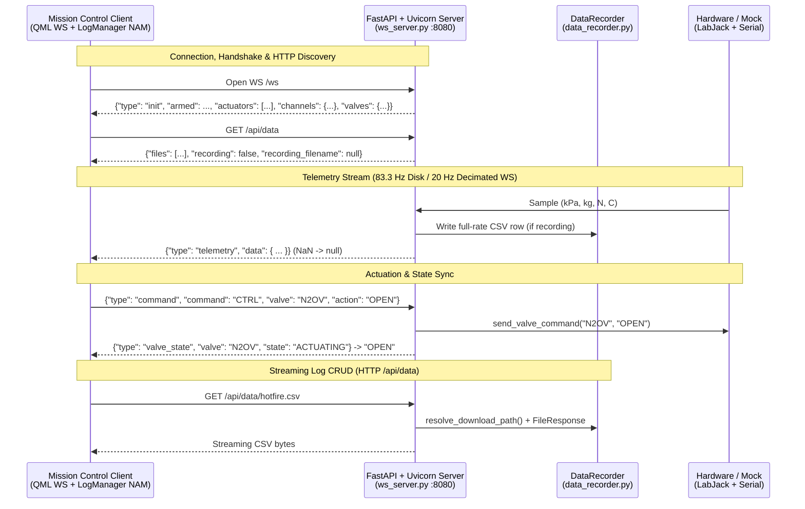

# WebSocket & HTTP `/api/data` Protocol Specification (Server ↔ Client)

This document specifies the **WebSocket (`WS /ws`)** and **HTTP (`/api/data/...`)** contract implemented by **Flow Control System Server** ([`contents/code/ws_server.py`](../contents/code/ws_server.py)) for **Flow Control System Client** (`Flow-Control-System-Client`).

For Arduino serial (`Controls.ino`) and LabJack U6 calibration details, see [`protocol-and-architecture.md`](./protocol-and-architecture.md) and [`actuation-spec.md`](./actuation-spec.md).

---

## 1. Transport & Endpoints

- **Base Bind:** `http://0.0.0.0:8080`
  - Valve Cart Mini PC: `ws://192.168.0.1:8080/ws` & `http://192.168.0.1:8080/api/data`
  - Local Dev / Mock: `ws://127.0.0.1:8080/ws` & `http://127.0.0.1:8080/api/data`
- **Multi-Client Registry:** Active sockets are tracked in `self.clients: set[Any]`. Outbound telemetry/state broadcasts handle stale disconnects safely without blocking other clients.

---

## 2. End-to-End Message & Request Flow



---

## 3. Connection Lifecycle Expectations

1. **Immediate Handshake (`init`):** On WS accept, `FlowControlWSServer.send_init()` sends `build_init_payload()` (including `"armed"`, `"recording"`, `"recording_filename"`, `"actuators"`, `"channels"` from `sensors.json`, and `"valves"`), plus any startup `connect_alert` (e.g., mock mode notice).
2. **Remote File Sync:** Client requests `GET /api/data` (falling back to WS `{"type": "remote_data_req", "operation": "list"}` in WebSocket-only mode).
3. **Recording Re-Sync:** If the client connects while already recording locally, it emits `{"type": "record", "active": true, "filename": ...}`; if the server is already recording on the same sanitized filename, the server preserves the open CSV file handle idempotently.

---

## 4. WebSocket Wire Protocol (`WS /ws`)

### 4.1 Server → Client Messages

#### A. Initial Handshake & Config (`type: "init" | "actuators" | "config"`)
```json
{
  "type": "init",
  "system": "Flow-Control-System-Server (Mock)",
  "armed": false,
  "recording": false,
  "recording_filename": null,
  "actuators": [
    {
      "id": "N2OV",
      "label": "N2O Valve (N2OV)",
      "type": "servo",
      "normal_state": "CLOSED",
      "states": ["OPEN", "CLOSED"],
      "hint": "2 LS",
      "key": "1"
    }
  ],
  "channels": {
    "P_INJECTOR": {"pin": "AIN82", "unit": "kPa", "mode": "DIFF", "gain_index": 100},
    "P_COMB_CHMBR": {"pin": "AIN85", "unit": "kPa", "mode": "DIFF", "gain_index": 100},
    "P_N2O_FLOW": {"pin": "AIN84", "unit": "kPa", "mode": "DIFF", "gain_index": 100},
    "P_N2_FLOW": {"pin": "AIN83", "unit": "kPa", "mode": "DIFF", "gain_index": 100},
    "P_RUN_TANK": {"pin": "AIN81", "unit": "kPa", "mode": "DIFF", "gain_index": 100},
    "M_RUN_TANK": {"pin": "AIN86", "unit": "kg", "mode": "DIFF", "gain_index": 1000},
    "L_THRUST": {"pin": "AIN87", "unit": "N", "mode": "DIFF", "gain_index": 1000},
    "T_RUN_TANK": {"pin": "AIN49", "unit": "C", "mode": "SING", "gain_index": 100, "thermocouple": true},
    "T_INJECTOR": {"pin": "AIN57", "unit": "C", "mode": "SING", "gain_index": 100, "thermocouple": true},
    "T_COMB_CHMBR": {"pin": "AIN55", "unit": "C", "mode": "SING", "gain_index": 100, "thermocouple": true},
    "T_POST_COMB": {"pin": "AIN53", "unit": "C", "mode": "SING", "gain_index": 100, "thermocouple": true}
  },
  "valves": {
    "N2OV": "CLOSED",
    "DUMP": "OPEN",
    "RTV": "CLOSED",
    "QD": "CONNECTED",
    "MEV": "READY",
    "MRV": "READY"
  }
}
```
Actuator definitions come directly from [`contents/config/actuators.json`](../contents/config/actuators.json) (`N2OV`, `DUMP`, `RTV`, `QD`, `MEV`, `MRV`).

#### B. Live Telemetry (`type: "telemetry"`)
Broadcasted decimated via `--rate` (default `20.0 Hz`) in engineering units (`kPa`, `kg`, `N`, `C`):
```json
{
  "type": "telemetry",
  "data": {
    "packet_id": 1042,
    "seconds": 104.2,
    "uptime": 104.2,
    "P_RUN_TANK": 5120.5,
    "P_INJECTOR": 3715.6,
    "M_RUN_TANK": 18.4,
    "L_THRUST": 1680.0,
    "T_RUN_TANK": 19.4,
    "T_INJECTOR": null
  }
}
```
`sanitize_telemetry_for_json()` converts non-finite floats (`math.nan`, `inf`) to `null` for strict RFC 8259 JSON encoding (`json.dumps(..., allow_nan=False)`).

#### C. Valve State (`type: "valve_state" | "summary"`), Armed (`type: "armed"`), Alert (`type: "alert"`)
- `update_valve_state` / `update_valve_summary` normalizes firmware states (`CLOSE`→`CLOSED`, `TRANSIT`→`ACTUATING`, `FILLING`→`FILL`, `VENTING`→`VENT`, `CONNECT`→`CONNECTED`, `DISCONNECT`→`DISCONNECTED`, `FIRE`→`FIRED`) before broadcasting.
- `set_armed(bool)` broadcasts `{"type": "armed", "armed": ...}`.
- `send_alert(level, message)` broadcasts `{"type": "alert", "level": "INFO"|"WARN"|"ERR", "message": ...}` (including open-thermocouple warnings and interlock blocks).

---

### 4.2 Client → Server Messages

| `type` / `command` | Schema | Server Interlocks & Action |
| :--- | :--- | :--- |
| `command` / `CTRL` | `{"type": "command", "command": "CTRL", "valve": "N2OV", "action": "OPEN"}` | `_check_actuator_interlocks()` blocks actuation if `not self.armed`, `vdef["external"]`, or `vdef["single_use"]` is already `FIRED`/`DISCONNECTED`. Sends `WARN` alert to requester if blocked; otherwise delegates to `serial_controller.send_valve_command()`. |
| `abort` / `ABORT` | `{"type": "abort", "command": "ABORT"}` | **Always permitted even when `armed == False`.** Dispatches `serial_controller.send_abort()`. |
| `unabort` / `UNABORT` | `{"type": "unabort", "command": "UNABORT"}` | Dispatches `serial_controller.send_unabort()`. |
| `summary` / `SUMMARY` | `{"type": "summary", "command": "SUMMARY"}` | Dispatches `serial_controller.request_summary()` or broadcasts `{"type": "summary", "valves": ...}`. |
| `armed` / `arm` / `safe` | `{"type": "armed", "armed": true}` | Updates `self.set_armed(...)`. |
| `record` / `RECORD` | `{"type": "record", "active": true|false, "filename": "..."}` | Opens/closes full-rate two-row CSV session in `data_dir`. Broadcasts `remote_data_list` on stop. |
| `remote_data_req` | `{"type": "remote_data_req", "operation": "list"|"get"|"put"|"rename"|"delete", ...}` | Legacy WS fallback matching the HTTP `/api/data` operations below. |

**Recorded Two-Row CSV Header Format (`sensors.json`):**
```csv
kPa,kPa,kPa,kPa,kPa,kg,N,C,C,C,C,s
P_INJECTOR,P_COMB_CHMBR,P_N2O_FLOW,P_N2_FLOW,P_RUN_TANK,M_RUN_TANK,L_THRUST,T_RUN_TANK,T_INJECTOR,T_COMB_CHMBR,T_POST_COMB,seconds
```

---

## 5. HTTP `/api/data` Endpoints (`ws_server.py` ↔ `DataRecorder`)

All filenames pass through `sanitize_filename()` (rejecting `/`, `\`, `..`, empty names) and `DataRecorder` enforces `.csv` / `.jsonl` extensions so reads/writes cannot escape `data_dir`.

| Method & Path | Request / Query | Response / Side Effect |
| :--- | :--- | :--- |
| `GET /api/data` | — | `{"files": [{"name": ..., "size": ..., "mtime": ...}, ...], "recording": bool, "recording_filename": str \| null}` |
| `GET /api/data/{filename}` | — | Streams `FileResponse(..., media_type="text/csv")` (`400` invalid name, `404` missing; flushes active recording if downloading active log) |
| `PUT /api/data/{filename}` | Raw CSV/JSONL body stream | Saves sanitized file into `data_dir`, broadcasts updated WS `remote_data_list`, returns `{"status": "ok", "filename": ..., "overwrote": bool, "bytes": int}` (`409` if writing to active recording) |
| `POST /api/data/{filename}/rename` | JSON `{"new_name": "..."}` | Renames file inside `data_dir`, broadcasts WS `remote_data_list`, returns `{"status": "ok", "old_name": ..., "new_name": ...}` (`404`/`409`) |
| `DELETE /api/data/{filename}` | — | Unlinks file from `data_dir` (used by client deferred deletion commits), broadcasts WS `remote_data_list`, returns `{"status": "ok", "filename": ...}` (`404`/`409`) |
